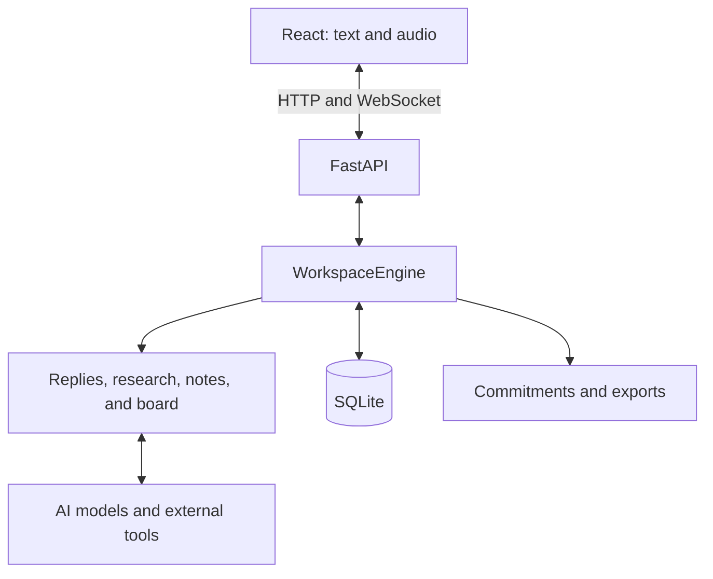

# Architecture

Quorumy uses a React frontend, a FastAPI server, and an agent engine. The server also serves the built interface.

## Code layout

| Path | Role |
| --- | --- |
| `frontend/src/` | Interface, audio capture, voice playback, and the server connection |
| `src/quorumy/workspace/api/` | HTTP routes, WebSocket messages, and access control |
| `src/quorumy/workspace/runtime.py` | Consent, sessions, and commitments |
| `src/quorumy/workspace/core/` | Orchestration, replies, research, notes, and the board |
| `src/quorumy/workspace/adapters/` | Voice, routing, connectors, and SQLite storage |
| `src/quorumy/workspace/integrations.py` | Registration of research tools |
| `src/quorumy/providers.py` | Web search |
| `src/quorumy/minutes.py` | Quotes, action validation, and exports |
| `tests/`, `scripts/` | Tests, setup, diagnostics, and release preparation |

## How a turn works

1. The user starts a session with the participants’ agreement. Typed or transcribed text joins the conversation.
2. The engine decides whether to remember, answer, or start a search. Searches can continue while the conversation does.
3. Results feed replies, notes, and the board. Voice is played progressively and can be interrupted.
4. Proposed commitments cite the original turns. The user confirms the owner and the date before a calendar export. Confirmed commitments return at the next meeting. A number or a decision that contradicts them raises a red hand, even if the model does not answer.
5. Pause stops capture and cancels work. A reopened or reconnected session stays paused until confirmation.

`WorkspaceEngine` extends the Quorumy engine. The account’s Hugging Face model routes turns, writes, and summarizes. Whisper transcribes and Kokoro speaks, with the same key. Web search needs no other key.

The browser watches the microphone and the meeting tab separately. Quorumy speaks only when given the floor. Otherwise it raises a hand, in red when a point is urgent.

## Memory and configuration

- The active state holds the transcript, notes, cards, and tasks.
- `.data/quorumy.sqlite3` stores sessions and their journal. Raw audio is not stored there.
- Each agent receives the context useful to its role. Local storage is not encrypted, and that context is sent to the providers that are called.
- `.data/config.json` sets models and providers. Keys stay in the environment, `.env`, or `.Secrets`.
- `QUORUMY_DATABASE_PATH` moves the database. For a manual backup, stop the server before copying it.

## Contract and access

The server listens on port `8765`, on every interface by default. One active session and one controlling tab are allowed per server. Messages are defined in `workspace/api/schemas.py`, then exported to OpenAPI and TypeScript.

In an external call, Quorumy captures the meeting audio; the meeting must share the Quorumy tab with its audio so replies can be heard. See the [audio guide](docs/demo-video.md).
